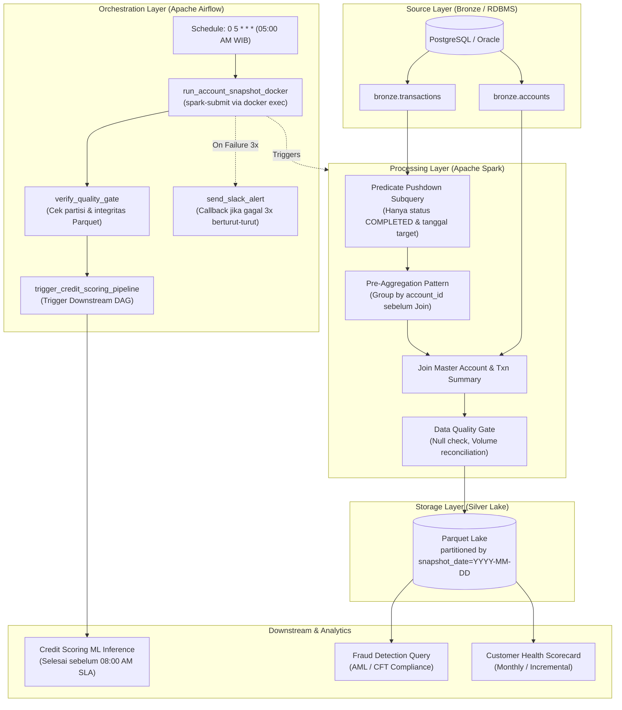

# 🏦 NegaraBank: Banking ETL Orchestration with Airflow & Spark

Platform *Data Engineering Enterprise* untuk perbankan yang mengimplementasikan pipeline data **Silver Layer (Daily Account Snapshot)** berstandar produksi. Proyek ini mengintegrasikan ekstraksi data bertahap (*incremental*), komputasi terdistribusi dengan **Apache Spark**, orkestrasi berbasis SLA dengan **Apache Airflow**, streaming broker **Apache Kafka**, serta analitik kepatuhan anti-fraud (OJK & AML/CFT) dan *credit scoring inference*.

---

## 📌 Daftar Isi
- [Arsitektur Sistem](#-arsitektur-sistem)
- [Teknologi Utama](#-teknologi-utama)
- [Struktur Repository](#-struktur-repository)
- [Fitur Utama & Best Practices](#-fitur-utama--best-practices)
- [Panduan Instalasi & Menjalankan](#-panduan-instalasi--menjalankan)
- [Detail Pipeline & Alur Data](#-detail-pipeline--alur-data)
- [Modul SQL & Analitik Kepatuhan](#-modul-sql--analitik-kepatuhan)
- [Monitoring & Alerting](#-monitoring--alerting)

---

## 🏗 Arsitektur Sistem

Berikut adalah alur data dan orkestrasi end-to-end:



---

## 🚀 Teknologi Utama

| Komponen | Teknologi | Versi | Fungsi |
| :--- | :--- | :--- | :--- |
| **Orchestrator** | Apache Airflow | `2.9.1` (Python 3.11) | Penjadwalan harian, SLA tracking, alert & trigger downstream |
| **Compute Engine**| Apache Spark | `3.5.1` (PySpark) | Pemrosesan batch distributed ETL, agregasi & quality gate |
| **Message Broker**| Apache Kafka | `3.8.0` | Ingestion streaming event perbankan |
| **Kafka UI** | Provectus Labs | `latest` | Dashboard pemantauan cluster & topic Kafka |
| **Storage Format**| Apache Parquet | Snappy Compressed | Penyimpanan data lake terpartisi *columnar* (Silver Layer) |
| **Database** | PostgreSQL / Oracle | JDBC 42.7.4 | Database sumber transaksional *core banking* |

---

## 📂 Struktur Repository

```text
banking-etl-orchestration-with-airflow-spark/
├── docker-compose.yml              # Konfigurasi container Kafka, Spark, dan Airflow
├── daily_account_snapshot_etl.py   # Skrip PySpark standalone Silver Layer ETL
├── check_dates.py                  # Skrip utilitas inspeksi rentang tanggal transaksi
├── README.md                       # Dokumentasi arsitektur dan panduan proyek
├── dags/                           # Folder DAGs Apache Airflow
│   ├── negarabank_account_snapshot_dag.py     # DAG utama: Snapshot harian + Quality Gate + Alert
│   └── credit_scoring_daily_inference_dag.py  # Downstream DAG: Model scoring kredit harian
├── src/
│   ├── main.py                     # CLI Entry point multi-job runner (--date, --job, --env)
│   ├── db/
│   │   └── secret_manager.py       # Pengambilan kredensial AWS Secrets Manager / Fallback .env
│   ├── jobs/
│   │   ├── job_banking_etl.py       # Versi awal/legacy (dilengkapi catatan anti-pattern)
│   │   ├── job_banking_etl_spark.py # Versi production-grade PySpark untuk Docker container
│   │   └── account_snapshot_job.py  # Class-based modular job runner
│   └── sql/
│       ├── monthly_customer_health_scorecard.sql        # Analisis scorecard bulanan per nasabah
│       ├── dbt_customer_health_scorecard_incremental.sql # Model dbt incremental scorecard
│       └── fraud_detection_patterns.sql                 # Pola deteksi transaksi berpotensi fraud
├── config/
│   ├── settings.py                 # Parser konfigurasi YAML
│   └── config/
│       ├── local.yaml              # Konfigurasi environment lokal
│       └── prod.yaml               # Konfigurasi environment produksi
└── banking_dataset_output/         # Direktori partisi Parquet (Silver Layer)
```

---

## 💡 Fitur Utama & Best Practices

1. **Incremental JDBC Pushdown**:
   Filter kueri SQL dilakukan langsung pada level database engine (`WHERE txn_date >= ... AND status = 'COMPLETED'`), menghindari *full table scan* dan meminimalkan transfer data ke Spark memory.
2. **Pre-Aggregation Pattern**:
   Transaksi perbankan diagregasikan per `account_id` terlebih dahulu sebelum dilakukan *join* dengan data master rekening. Pola ini mengeliminasi *wide shuffle* data bervolume besar dan mencegah error *Out of Memory* (OOM).
3. **Idempotent Partition Overwrite**:
   Menggunakan pengaturan Spark `spark.sql.sources.partitionOverwriteMode=dynamic`. Menulis ulang tanggal yang sama bersifat aman (menimpa partisi lama tanpa merusak tanggal lain) dan dapat di-*append* untuk tanggal baru.
4. **Data Quality Gate Terintegrasi**:
   Validasi otomatis sebelum penyimpanan:
   - Pengecekan row count (tidak boleh kosong).
   - Null check pada kolom kunci (`account_id`, `customer_id`, `balance`, `snapshot_date`).
   - Rekonsiliasi total volume debit/kredit dan jumlah transaksi terhadap data mentah sumber.
5. **Resilient Scheduling & Alerting**:
   - Jadwal harian pukul **05:00 AM WIB** (`0 5 * * *`).
   - Mekanisme **retry 3x** dengan jeda **exponential backoff** (5m, 10m, 20m).
   - Integrasi webhook **Slack** otomatis terpicu jika terjadi kegagalan total setelah 3 kali percobaan.
   - Pemicu otomatis pipeline hilir **Credit Scoring** agar SLA bisnis (selesai sebelum jam 08:00 AM) terpenuhi.

---

## 🛠 Panduan Instalasi & Menjalankan

### 1. Prasyarat
- Docker Desktop & Docker Compose telah terpasang.
- Git & Python 3.10+ (opsional untuk eksekusi lokal).

### 2. Konfigurasi Environment
Buat file `.env` di root direktori (atau sesuaikan dengan `.env.example`):
```bash
POSTGRES_HOST=host.docker.internal
POSTGRES_PORT=5432
POSTGRES_DB=belajar_db
POSTGRES_USER=postgres
POSTGRES_PASSWORD=your_secure_password
ENV=local
```

### 3. Menjalankan Cluster Kontainer
Jalankan semua layanan (Kafka, Spark, Airflow) di latar belakang:
```bash
docker compose up -d
```

Verifikasi port antarmuka web:
- **Airflow Webserver**: [http://localhost:8080](http://localhost:8080)
- **Spark Master UI**: [http://localhost:8081](http://localhost:8081)
- **Kafka UI**: [http://localhost:8085](http://localhost:8085)

### 4. Eksekusi Job ETL Manual
Untuk menjalankan job snapshot secara manual ke dalam kontainer Spark:

```bash
docker exec -e POSTGRES_PASSWORD="your_password" negarabank-spark \
  /opt/spark/bin/spark-submit \
  --master "local[*]" \
  /opt/negarabank/src/jobs/job_banking_etl_spark.py \
  --date 2026-01-20
```

Atau menggunakan runner CLI modular:
```bash
python src/main.py --job ACCOUNT_SNAPSHOT --date 2026-01-20 --env local
```

Untuk rentang tanggal (*backfill*):
```bash
python src/main.py --job ACCOUNT_SNAPSHOT --startdate 2026-01-01 --enddate 2026-01-20 --env local
```

---

## 📊 Detail Pipeline & Alur Data

### Skema Output Silver Layer (`banking_dataset_output`)
Tabel disimpan dalam format Parquet dengan partisi direktori `snapshot_date=YYYY-MM-DD`:

| Nama Kolom | Tipe Data | Deskripsi |
| :--- | :--- | :--- |
| `snapshot_date` | `STRING (Partition Key)` | Tanggal snapshot akun |
| `account_id` | `STRING / LONG` | ID Rekening / Akun |
| `customer_id` | `STRING / LONG` | ID Nasabah pemilik rekening |
| `account_type` | `STRING` | Jenis akun (`SAVINGS`, `CURRENT`, `CREDIT_CARD`, dll.) |
| `product_name` | `STRING` | Nama produk perbankan |
| `opened_date` | `DATE / TIMESTAMP` | Tanggal pembukaan rekening |
| `status` | `STRING` | Status akun (`ACTIVE`, `DORMANT`, `CLOSED`) |
| `balance` | `DOUBLE` | Saldo berjalan pada tanggal snapshot |
| `credit_limit` | `DOUBLE` | Limit kredit (jika jenis kartu kredit) |
| `daily_txn_count` | `LONG` | Total frekuensi transaksi selesai pada tanggal tersebut |
| `daily_txn_amount` | `DOUBLE` | Total nilai nominal transaksi selesai pada tanggal tersebut |
| `daily_debit_amount` | `DOUBLE` | Total nominal transaksi debit / keluar |
| `daily_credit_amount` | `DOUBLE` | Total nominal transaksi kredit / masuk |

---

## 🔍 Modul SQL & Analitik Kepatuhan

Repository ini menyediakan kueri analitik berbasis SQL di folder `src/sql/`:

1. **Deteksi Transaksi Fraud ([fraud_detection_patterns.sql](src/sql/fraud_detection_patterns.sql))**:
   - **Velocity Spike**: 5 atau lebih transaksi dalam kurun waktu 1 jam menggunakan window frame `RANGE BETWEEN 3600 PRECEDING AND CURRENT ROW`.
   - **High-Value Surge**: Transaksi mendadak dengan nilai jauh melampaui riwayat rata-rata.
   - **Structuring / Smurfing**: Pemecahan transaksi beruntun tepat di bawah batas pelaporan PPATK/OJK.
   - **High-Risk Merchant**: Aktivitas pada kategori merchant yang masuk daftar pemantauan khusus.
2. **Customer Health Scorecard ([monthly_customer_health_scorecard.sql](src/sql/monthly_customer_health_scorecard.sql))**:
   - Agregasi rasio utilisasi kartu kredit (`cc_balance / cc_credit_limit`).
   - Pemetaan saluran transaksi per nasabah (QRIS, Mobile Banking, Internet Banking, ATM, Auto Debit).
   - Klasifikasi profil risiko dan kelayakan kredit bulanan.

---

## 🚨 Monitoring & Alerting

Jika terjadi kendala pada pipeline snapshot:
- **SLA Alert**: Notifikasi *early-warning* jika proses belum tuntas mendekati batas waktu.
- **Slack Alert Payload**: Mengirim detail nama DAG, task ID, tanggal eksekusi, nomor percobaan (try count), cuplikan error, dan tautan langsung ke log Airflow.

